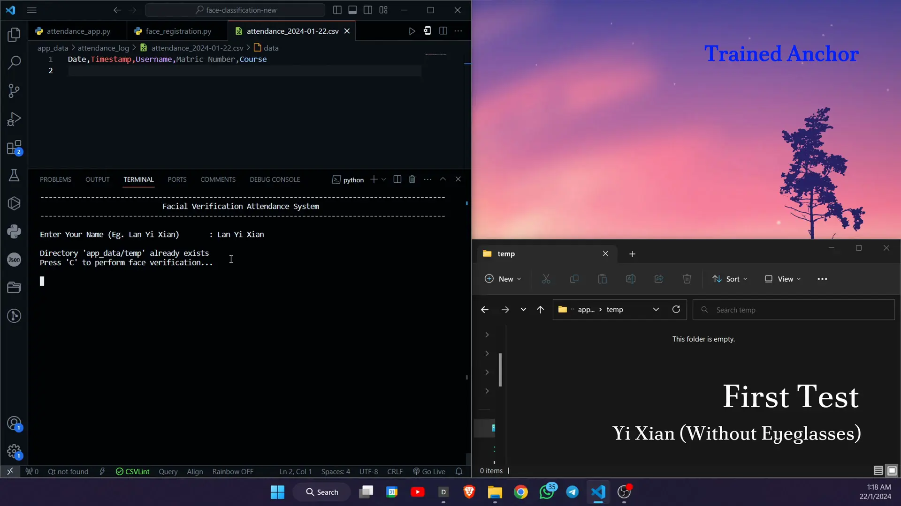
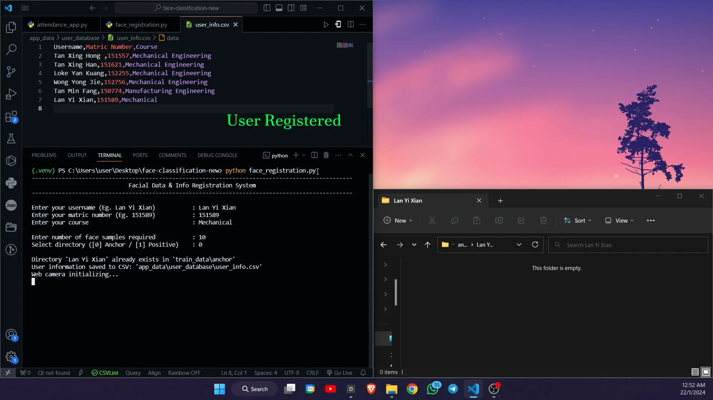
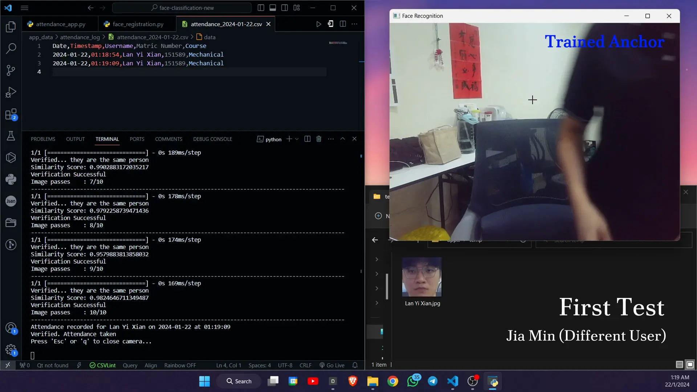
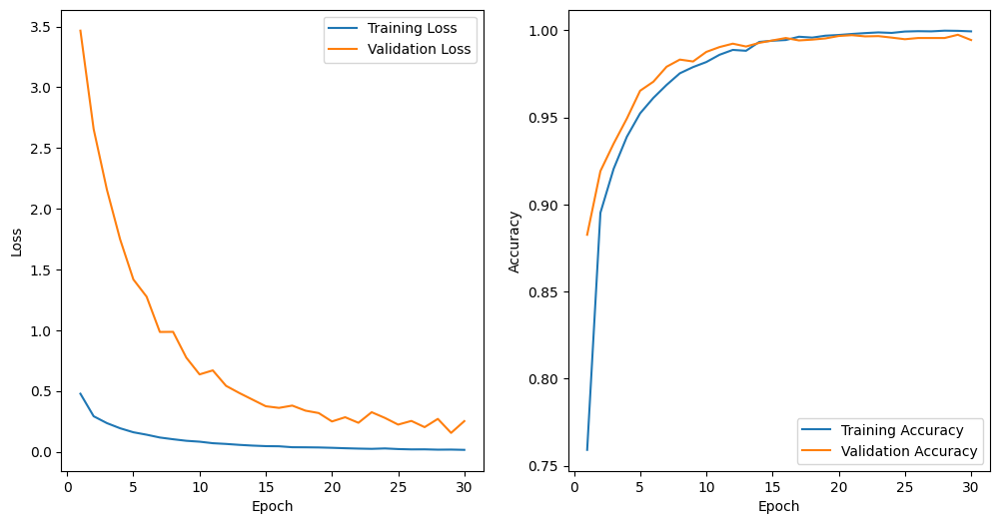
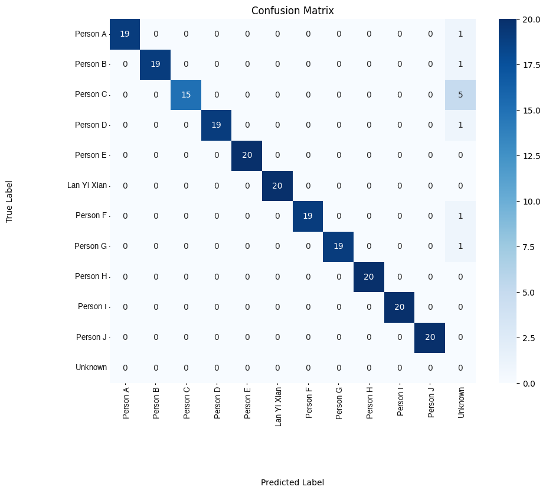

# Face Recognition Attendance System (Siamese Network)

A webcam attendance system that verifies a person's identity with a Siamese neural network, so new people can be registered from a few photos without retraining the model.

> ✅ **Status:** Complete · Jan 2024 team project, EPE461 Industrial Machine Vision, Universiti Sains Malaysia · 🔗 [LinkedIn project](https://www.linkedin.com/in/yixianlan/details/projects/)

<p align="center">
  
</p>

## Overview

Card swipes, QR codes and sign-in sheets all allow **buddy punching**: someone checks in for an absent friend. Face recognition fixes that, but a typical face recognition model is a classifier, and every new person means collecting data and retraining.

This project uses **one-shot verification** instead. The model never learns *who* people are. It learns to answer a single question: **are these two faces the same person?** Registering someone new only means saving their reference photos. The model stays the same.

This project followed an [early prototype](https://github.com/yx-elite/face-recognition-attendance-vggface) built on the pretrained VGG-Face model. For the final system, we **designed and trained our own CNN** instead of relying on a pretrained black box.

## Demo

**Registration:** enter details, then capture reference faces from the webcam.

<p align="center">
  
</p>

**Impostor rejected:** a different person tries to check in under a registered name, and attendance is not taken.

<p align="center">
  
</p>

## Architecture

<p align="center">
  
</p>

**1. Registration** (`face_registration.py`)
- A command-line tool registers a person (name, ID, course) into a CSV user database
- A webcam captures their face: OpenCV's Haar cascade detects it, and it's cropped and saved as reference images

**2. Siamese network**

<p align="center">
  
</p>

- Two identical CNN branches with **shared weights** turn each face (224 × 224 px) into a 4,096-dimension feature vector
- The embedding CNN's depth, filter sizes and layer count were tuned by trial and error
- An **L1 (Manhattan) distance layer** measures how different the two vectors are, and a sigmoid output turns that into a similarity score from 0 to 1

**3. Attendance** (`attendance_app.py`)
- Captures one frame of the person's face and compares it against **10 of their stored reference images**
- **Detection threshold 0.6:** each pair counts as a match if its similarity score is above 0.6
- **Verification threshold 0.7:** attendance is recorded only if **at least 7 of the 10 comparisons match**, which filters out one-off false matches
- Writes a daily attendance CSV with the date, time and user details

## Dataset & Training

- **Data collection:** 600 face images (anchor + positive) per person for **20 people**, captured with a 2K webcam
- **Pairs:** each person's anchors are paired with their own positives (label 1) and with other people's faces as negatives (label 0), giving **4,560 balanced, labelled pairs**, split 70% training / 30% testing
- **Preprocessing:** grayscale for detection, face cropping, resizing to 224 × 224, normalisation to [0, 1]
- **Augmentation:** random horizontal flips, small rotations and brightness changes, applied to half the training pairs to reduce overfitting
- **Training:** 30 epochs, batch size 16, learning rate 1e-5, binary cross-entropy loss, custom `tf.GradientTape` training loop, on a Google Colab GPU

## Results

| Metric | Result |
|---|---|
| Training accuracy | 99.94% (loss 0.0146) |
| Validation accuracy | **99.44%** (loss 0.2513) |
| Held-out test set (220 images, 11 people) | **95%** (209 / 220) |
| Precision per registered person | **1.00** |

Every one of the 11 misses was rejected as **unknown**. No one was ever identified as someone else, which is the failure that matters most for attendance.

<table>
  <tr>
    <td width="50%" align="center"><br><sub>Training and validation curves over 30 epochs</sub></td>
    <td width="50%" align="center"><br><sub>Held-out test set. Classmates' names replaced for privacy.</sub></td>
  </tr>
</table>

## Tech Stack

Python · TensorFlow / Keras · OpenCV · NumPy · pandas · scikit-learn · Matplotlib · Google Colab

## Getting Started

```bash
pip install -r requirements.txt
python face_registration.py   # register a person and capture reference images
python attendance_app.py      # verify a face and record attendance
```

The trained model (`.h5`) and face dataset aren't included, for size and privacy reasons. Use the training notebooks to train your own. Paths are Windows-style, and the webcam is set to device index `1`.

| Notebook | Purpose |
|---|---|
| `siamese_oneshot_model_train.ipynb` | Main training run, with loss and accuracy curves |
| `siamese_xh_model_train.ipynb` | Training with data augmentation |
| `siamese_confusion_matrix.ipynb` | Per-person classification report and confusion matrix |
| `siamese_metric_tptnfpfn.ipynb` / `siamese_metric_display.ipynb` | Pair-level TP / TN / FP / FN analysis |

Notebook outputs are cleared to keep the face dataset private.

## Limitations & Lessons Learned

- **Verification beats classification for changing groups:** adding a person shouldn't mean retraining
- **One comparison isn't enough:** a single pair can produce a false match, but voting across 10 reference images made decisions reliable
- **Haar cascades are a weak link:** loose crops left background in the face images and added noise. A modern detector (RetinaFace, MTCNN, YuNet) would crop more precisely
- **Dataset bias:** the data came from one class of students, so it isn't balanced across gender or ethnicity, and identical twins remain hard to tell apart
- **Limited compute:** the free Colab GPU forced smaller training and test sets
- **Today I'd:** use a pretrained face embedding (FaceNet or ArcFace) with triplet loss, add liveness detection so a photo can't be used to check in, and run it as a cloud service with consent and data-retention controls for the face data

## Team

Team project for EPE461 Industrial Machine Vision (Semester 1, 2023/2024), Universiti Sains Malaysia, with Tan Xing Hong and Tan Xing Han.

**My role:** I led development and wrote most of the codebase: the face registration tool, the Siamese network training pipeline, model evaluation, and the attendance app.

## Related Work

This is one of three approaches I explored for face recognition:

- [face-recognition-attendance-vggface](https://github.com/yx-elite/face-recognition-attendance-vggface): the earlier prototype, using pretrained VGG-Face embeddings compared by cosine and Euclidean distance
- [face-recognition-cnn-vs-transfer-learning](https://github.com/yx-elite/face-recognition-cnn-vs-transfer-learning): custom CNN vs. ResNet50 transfer learning in MATLAB, with an ablation study
